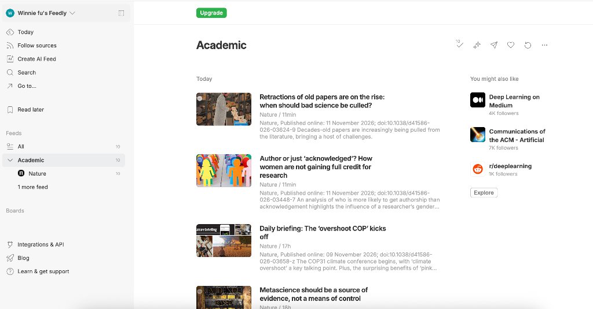
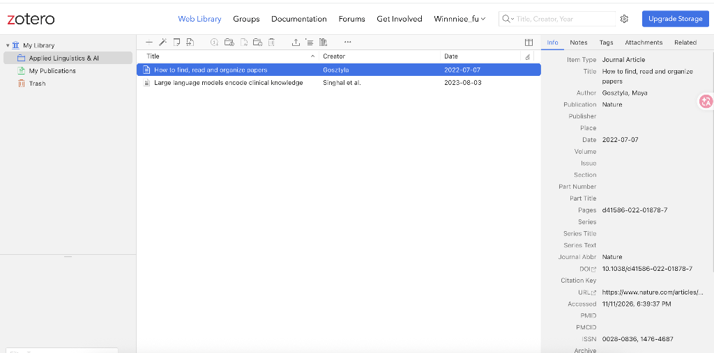

# Entry 2 — Introduction to Agentic AI: a hands-on lesson for academic literature management

**Series:** *Prompt & Praxis — Experiments in AI and professional communication* (A working series for IEEE ProComm)  
**Publication date:** 13 November 2026  
**Authors:**
- **Dr Simon Wang** (Lead Author) · Lecturer in English and Innovation Officer, Language Centre, Hong Kong Baptist University
- **Wenyun (Winnie) FU** (Co-author) · Final year student at HKBU (Journalism)
- **Zian (Andy) Zheng** (Co-author) · Final year student at HKBU (Computer Science)

**Author Biographies:**
- **Dr Simon Wang**: Lecturer in English and Innovation Officer, Language Centre, Hong Kong Baptist University. Researches and designs AI applications for professional communication education.
- **Wenyun (Winnie) FU**: Final-year student at HKBU (Journalism). Explores AI-assisted communication, human-in-the-loop writing workflows, and academic literature synthesis.
- **Zian (Andy) Zheng**: Final-year student at HKBU (Computer Science). Focuses on agentic AI pipelines, software prototyping, and API orchestration.

*(Visual presentation note: Author cards render with Nobel Prize winner portrait sketch styling, 1-line bios, and interactive toggle layout matching the Entry 1 visual hierarchy.)*

**Table of Contents (Series Navigation):**
- [Entry 1 — From plain texts to playable](https://blog.simonsays.hk/ieee/01.html) · *earlier entry*
- [Entry 2 — Introduction to Agentic AI: a hands-on lesson for academic literature management](https://blog.simonsays.hk/ieee/02.html) · *reading now*

*(Later entries follow every two weeks. Replaces theme intra-page heading TOC; 'continue reading' button removed.)*

**Standfirst:** A researcher's hundred open tabs, a column that told her to build a system, and the two steps where most systems still leak: now handed to instruments that do not have hands.

---

## Part 1 — A hundred open tabs: the problem every researcher recognises

In July 2022, Maya Gosztyla wrote in the [*Nature* Career Column](https://www.nature.com/articles/d41586-022-01878-7) about the evening her laptop died. She had more than a hundred papers waiting in browser tabs, each one a promise to read later. When the crash took the tabs, her first feeling was relief: the loss finally forced the decision she had been postponing: build a system, or face another semester of re-reading the same pages (Gosztyla, 2022).

Her article outlined four foundational steps: **find, manage, read, organize**. Finding is where collections begin to leak: papers promised for later, alerts that flood the inbox, and the good intentions of a Friday afternoon. Managing is where those intentions either solidify into an indexed database or vanish. The final two steps, reading and organizing, demand human critical judgement and cannot be outsourced to a script.

This entry takes on the first two steps. Following Gosztyla's lead, it starts where she started: with the conventional tools that were already on our desktops.

## Part 2 — The solutions she proposed (no AI in sight)

Her fixes were conventional, and they still work.

### Step 1 — find

Stop hunting; subscribe. The underlying plumbing is **RSS (Really Simple Syndication)**. Every journal that offers it publishes a small XML file, its *feed*, at a fixed web address. An **RSS reader** (a web app, a desktop program, or a mobile client) periodically queries those addresses for you and aggregates whatever is new. You subscribe once, and the literature comes directly to your desk: no emails to delete, no journal homepages to browse manually, and nothing lost when a laptop crashes.

Setting up an RSS workflow takes less than ten minutes:

1. **Choose a reader.** Web readers such as [Feedly](https://feedly.com) or [Inoreader](https://www.inoreader.com) require no local installation; desktop and mobile readers exist for offline reading. Both were among Gosztyla's primary recommendations.
2. **Subscribe with feed addresses.** Paste verified feed URLs directly into your reader. For example: [*Nature*](https://www.nature.com/nature.rss), [*Nature Communications*](https://www.nature.com/ncomms.rss), or [arXiv cs.AI](https://rss.arxiv.org/rss/cs.AI).
3. **Establish a five-minute morning routine.** Glance through incoming titles with your morning tea, move genuinely interesting papers to a *Read Later* shelf, and close the reader.

> **Demo: subscribing in Feedly (5 minutes)**
> 1. Open [feedly.com](https://feedly.com) and create a free account.
> 2. Click **Follow Sources** in the sidebar, paste a feed URL (such as `https://www.nature.com/nature.rss` or `https://rss.arxiv.org/rss/cs.AI`), and assign it to a new collection named **Academic**.
> 3. The latest table of contents immediately populates your reading stream. Tomorrow morning's scan is already waiting, neatly separated from your inbox.


> **Figure 1** · *Subscribing to journal feeds in Feedly.* In this illustrative example, an 'Academic' collection aggregates incoming issues from journals like *Nature* and *arXiv cs.AI* into a single reading stream, allowing rapid morning triage without opening multiple browser tabs.

For deeper exploratory mapping, Gosztyla also pointed to citation-visualisation tools such as ResearchRabbit, Connected Papers, and Litmaps to trace intellectual lineages. The governing principle: **let the literature come to you on a predictable schedule**, rather than hunting for papers between meetings.

### Step 2 — manage

If you are still formatting your references manually, stop right now.

That was Gosztyla's immediate advice in *Nature*. Too many early-career researchers treat reference managers purely as citation formatters, called upon only during manuscript submission. In reality, a modern reference manager is a personal research database. It stores full-text PDFs alongside verified bibliographic records, keeps annotations linked to specific pages, integrates directly with word processors, and captures papers from the web in a single click.

We demonstrate **Zotero** (free, open source, [zotero.org](https://www.zotero.org)) here. Because Zotero is open source, its underlying metadata-scraping and citation-formatting engines can be inspected and reused in automated pipelines. Commercial managers like Mendeley and EndNote follow similar patterns, but Zotero's open architecture gives scholars permanent data ownership.

Zotero supports five fundamental operations that complete the managing loop:

| Operation | What you do in Zotero | Workflow Advantage |
|---|---|---|
| **Import** | One click via the browser connector; or by DOI, PubMed ID, RIS/BibTeX file, or PDF drag-and-drop | Captures title, authors, journal metadata, and full PDF automatically without copy-pasting |
| **Organize** | File items into project *Collections*, assign tags, run saved searches, and detect duplicates | Keeps research organized by topic or project without duplicating local files |
| **Read & annotate** | Built-in PDF reader; color-code highlights and extract notes directly into the record | Highlights and notes remain permanently attached to the bibliographic entry |
| **Cite** | Word-processor plug-in for Microsoft Word, LibreOffice, and Google Docs | Thousands of citation styles; the bibliography formats and updates itself |
| **Share & export** | Secure multi-device sync, collaborative group libraries, and clean BibTeX/RIS export | Enables seamless co-authoring without metadata corruption |

> **Demo: managing a paper in Zotero (5 minutes)**
> 1. Set up a free library on [zotero.org](https://www.zotero.org) (accessible via desktop app or Web Library) and install the Zotero Connector extension.
> 2. Create a project collection (for example, **Applied Linguistics & AI**).
> 3. In your browser, open any journal article or paper page of interest (for example, Maya Gosztyla's [*Nature* column](https://www.nature.com/articles/d41586-022-01878-7) or an article from *arXiv*), and click the Zotero Connector icon in your toolbar.
> 4. The connector extracts verified bibliographic metadata (title, authors, publication date, DOI, abstract) and files the entry into your chosen collection.
> 5. The browser tab can now be closed: the paper is securely saved in your permanent research library.


> **Figure 2** · *Literature management in Zotero (Web Library).* Incoming papers are filed into a project collection ('Applied Linguistics & AI' in this illustrative example), with complete bibliographic metadata, source URL, and DOI captured in a single click without manual re-typing.

Gosztyla's working rule was crisp: the moment you decide a paper is worth reading, send it into the reference manager, and close the browser tab. That intentional close is the entire discipline.

Two steps, two conventional tools, and one honest limitation: everything in Part 2 is operated **by hand, on a screen, one click at a time**. That physical ceiling opens the door to Part 3.

## Part 3 — GUI against API: the boundary Entry 1 already crossed

### What the GUI is, and where it stops

Every tool in Part 2 relies on a graphical user interface (GUI): what you see is what you get. That visual nature is its virtue: intuitive, friendly, allowing a newcomer to become productive within minutes.

It is also its boundary. A GUI can only display **one screen at a time**, and its pace is governed by human physical limits: how quickly fingers can click, how long eyes can scan without fatigue, and how many open tabs short-term memory can juggle before losing orientation. A browser screen cannot check for new papers while you teach class. It cannot reproduce yesterday's exact multi-filter search next week without re-typing. Gosztyla's hundred open tabs were not personal disorganisation; they were the inevitable symptom of GUI-bounded manual searching.

### How Entry 1 crossed it

[Entry 1](https://blog.simonsays.hk/ieee/01.html) established a different principle: an AI agent sits between human language and computing instruments. You describe a job in ordinary sentences, and the agent orchestrates the underlying tools to execute multi-step workflows.

Crucially, Entry 1 drew a boundary we preserve here: **an agent is a reasoning engine and workflow processor, not an authoritative information oracle.** Its strength lies in action, not ungrounded memory. This entry never asks a model to hallucinate what the literature says; it directs the agent to query verified scientific databases directly.

### Code as the way past the boundary: the two instruments

Programmed code does not have hands or eyes. It can execute a query at dawn, scan twenty-six thousand records while you make coffee, and rerun yesterday's exact search next month without variation. A researcher's effective reach expands from what hands can click during an afternoon to whatever can be formulated as a systematic task.

Two digital instruments carry that workload:

- **An Application Programming Interface (API)** operates like a service counter with a fixed menu. You request structured data in a defined format, and the server returns exact, machine-readable records without chat. For example, this address is a live API call to OpenAlex:

  ```
  https://api.openalex.org/works?search=applied linguistics AI&per-page=3
  ```

  Within milliseconds, it returns three verified papers, each with its DOI. Across OpenAlex, that single query matches 26,881 publications.² No search box to click, no endless scrolling, and zero open tabs.

- **Syndicated Feeds (RSS)** provide automated delivery in the opposite direction. Instead of visiting dozens of journals, new tables of contents arrive automatically at an endpoint. Try pointing your reader or agent here:

  ```
  https://rss.arxiv.org/rss/cs.AI
  ```

  While Part 2 treated RSS as a personal reading stream, in an agentic pipeline an agent watches the feed, compares incoming abstracts with your research criteria, and flags only genuinely relevant developments.

### What the two instruments accomplish, in her context

| Literature Step | Traditional GUI (Hands, one screen at a time) | Agent + API (Instruments doing the reaching) |
|---|---|---|
| **1. Find** | Manual keyword searches; alerts that flood the inbox; repeated query typing each week | An agent queries OpenAlex via API on a set schedule, returning a deduplicated, DOI-verified list |
| **2. Manage** | Clicking browser extension icons; manual sorting into folders; manual file renaming | The query formats results into CSV and BibTeX tables, feeding directly into Zotero with records and PDFs filed together |

The GUI does not vanish. It returns to where human judgement belongs: reading critically, assessing evidence, and deciding what to build next.

In Part 4, we put this pipeline directly into practice using **WorkBuddy**.

## Part 4 — How you do that, with WorkBuddy

The pipeline is published and free to take apart: **[`workshop/`](https://github.com/tesolchina/procomm-microlearning/tree/main/workshop)** carries the prompts, the script and the expected outputs. Two tracks — pick one.

### Track A — write it from scratch

**A1 — make it explain first (30 seconds).** Paste:

> I'm new to this. Before doing anything: tell me in three lines what this prompt would do, what you need from me, and what could go wrong. Don't run it yet.
>
> "Find the 10 most-cited papers on *your topic* published since *year*, from OpenAlex, and show me title, year, citations, and DOI."

If it starts running without explaining, say *"explain first."* You are training the workflow as much as using it.

**A2 — your first query (2 minutes).** Ask for the ten most-cited articles on your topic since a given year, as a table of **title | year | citations | DOI**, with `mailto=your.email@example.com` on the request — OpenAlex's polite pool. House rule: *do not invent or complete any row; if the API returns nothing, say so.* Open one DOI; it must reach the paper.

**A3 — keep it (3 minutes).** Ask for `found.csv` and a Google Doc tab "Reading list — *your topic*" with Status and Notes columns. Close the hunting tabs. That close is the point.

**A4 — hand it to Zotero (5 minutes).** BibTeX export plus the menu steps to import, and it waits for your confirmation before acting. Zotero is free and open source; the record is yours.

**A5 — build on it.** Change one thing per run: topic, sort, or last week's date window — that last one makes a weekly literature alert.

### Track B — reuse the code we share

1. Open [`workshop/prompts/beginner-pack.md`](https://github.com/tesolchina/procomm-microlearning/blob/main/workshop/prompts/beginner-pack.md).
2. Send the link to your agent: *"Describe what this code does and how I can reuse it for my own topic."*
3. Run Level 1, Level 2, Level 3 as printed.
4. Then break it on purpose — change the topic, the year, the sort. Reusing code means editing it.

**One difference worth knowing:** WorkBuddy returns tables in the chat; VS Code and Cursor work in a folder, so `found.csv` and `found.bib` land beside the code. The prompts are identical; the paste point changes.

## Part 5 — Decisions, limits, what it is worth

**Decisions.** Two steps only, because an entry that does everything teaches nothing. Both instruments, because some literature should arrive by itself and some questions should be asked on demand. Remix over rebuild for Zotero: take one simpler module apart instead of writing a reference manager — its source is public, and its licence was checked before anything of ours was shared.

**Limits.** An agent asked to *remember* a paper invents one that sounds right; asked to *fetch* it, it cannot — so every value above arrives from OpenAlex or does not appear. A DOI proves a paper is real, not that its findings are right. RSS still needs a human to decide what deserves a click. And a public API stays free because its users are polite: one `mailto`, no hammering.

**Value.** An afternoon of tab-hunting becomes a two-minute query, and the second run is free: this Friday's search is last Friday's script with a new date. The list that returns is already sorted and filed, yours to filter by project. Gosztyla's answer to her own crisis was a system. This is that system's first two steps, running on instruments a beginner can drive in an afternoon.

## Closing — the cycle this starts

One query on one real topic returns a table too good not to open. The reader opens one. Tomorrow the same prompt returns something new, and the pipeline stops being a demo and becomes theirs. The platform first, the habit second — the reading, the notes and the organizing get picked up the same way, one working piece at a time.

---

**Footnotes:** ¹ Gosztyla, M. (2022). *How to find, read and organize papers*. Nature Careers, 07 July 2022. doi:10.1038/d41586-022-01878-7. ² OpenAlex verified 8 Nov 2026: 26,881 results for `search=applied linguistics AI`, `from_publication_date:2026-01-01`. ³ WorkBuddy capability test Stage 1 (GET) passed 7 Nov 2026 — [procomm#9](https://github.com/tesolchina/procomm-microlearning/issues/9). ⁴ Zotero source: github.com/zotero/zotero; licence check logged in [#12](https://github.com/tesolchina/procomm-microlearning/issues/12).

**Reviewer box:** Bremen Vance · Comments: open, moderated · Companion code: `workshop/`.

*≈1,400 words. De-AI pass applied at assembly (WI-6, #14): tells checklist + `humanize_check.py` before deploy.*
