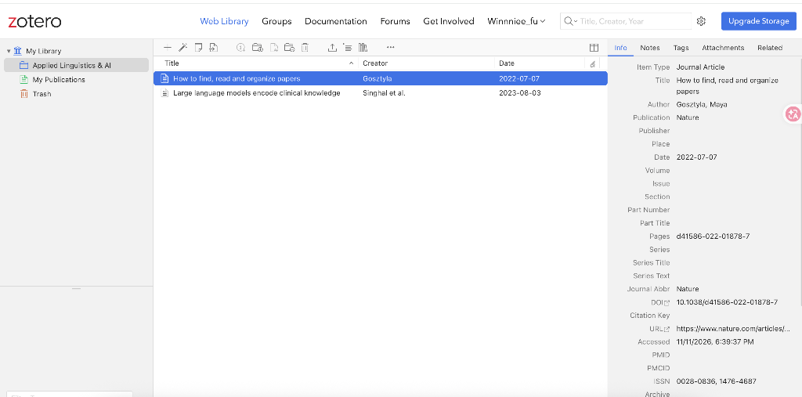

# Entry 2: Introduction to Agentic AI, a hands-on lesson for academic literature management

**Series:** *Prompt & Praxis* (IEEE ProComm) · **Publication date:** 13 November 2026 · **Series Host:** Dr Simon Wang (Language Centre, HKBU)

**Guest Authors:**
- **Wenyun (Winnie) FU**, final-year Journalism undergraduate, HKBU. Human-in-the-loop writing workflows, source verification, literature synthesis.
- **Zian (Andy) Zheng**, final-year Computer Science undergraduate, HKBU. Agentic pipelines, prototyping, API orchestration.

**Table of Contents (Series Navigation):**
- [Entry 1: From plain texts to playable](https://procomm.ieee.org/ai-resources/prompt-and-praxis/entry01/) · *earlier entry*
- [Entry 2: Introduction to Agentic AI](https://procomm.ieee.org/ai-resources/prompt-and-praxis/entry02/) · *reading now*

**Standfirst:** "I'll read that later," she told herself, adding yet another paper to a hundred open browser tabs. A Nature column answered that evening: stop hunting, build a system. This entry takes the system's first two steps, shows where they still leak, and gives the leaking parts to code.

---

## Part 1: A hundred open tabs

In July 2022, Maya Gosztyla wrote in the [*Nature* Career Column](https://www.nature.com/articles/d41586-022-01878-7) about the evening her laptop died. More than a hundred papers were waiting in browser tabs, each a promise to read later. When the crash took them, her first feeling was relief: the loss forced a decision she had been postponing.¹

Her article outlined four steps: **find, manage, read, organize**. The first, finding, means locating the journal articles that are relevant to the researcher's interests and agenda. It is also where collections begin to leak: papers promised for later, alerts that flood the inbox, and the good intentions of a Friday afternoon. The second, managing, decides whether those intentions solidify into an indexed database or vanish. Reading and organizing remain human work; no script can supply the critical judgement they demand.

This entry takes the first two, starting where she started: with the tools already on our desktops.

## Part 2: The solutions she proposed (no AI in sight)

Her fixes were conventional, and they work.

### Step 1: find

Stop hunting; subscribe. The plumbing is **RSS (Really Simple Syndication)**: every journal that offers it publishes a small XML *feed* at a fixed address, and an **RSS reader** polls those addresses on a schedule. You subscribe once, and the literature arrives.

1. **Choose a reader.** Web readers such as [Feedly](https://feedly.com) or [Inoreader](https://www.inoreader.com) need no installation; desktop and mobile readers work offline. Both were her recommendations.
2. **Subscribe with feed addresses.** Paste verified URLs into your reader: [*Nature*](https://www.nature.com/nature.rss), [*Nature Communications*](https://www.nature.com/ncomms.rss), [arXiv cs.AI](https://rss.arxiv.org/rss/cs.AI).
3. **Keep a five-minute morning routine.** Scan titles with your tea, move real candidates to *Read Later*, close the reader.


> **Figure 1** · *Subscribing to journal feeds in Feedly.* An 'Academic' collection aggregates incoming issues from journals like *Nature* and *arXiv cs.AI* into one reading stream, so morning triage needs no extra tabs.

She pointed to citation-visualisation tools such as ResearchRabbit and Litmaps.

### Step 2: manage

If you still format references by hand, stop. Gosztyla treated a reference manager as a personal research database. Full-text PDFs sit beside verified records. Annotations stay bound to the page they came from, and one click pulls a paper off the web.

We use **Zotero** (free, open source, [zotero.org](https://www.zotero.org)): its metadata and citation engines can be inspected and reused in automated pipelines, and its open architecture keeps data in the scholar's hands. Mendeley and EndNote follow similar patterns.

Five operations complete the loop:

| Operation | What you do in Zotero | Advantage |
|---|---|---|
| **Import** | Browser connector, or by DOI, RIS/BibTeX, PDF drag-and-drop | Metadata and full PDF, no copy-pasting |
| **Organize** | Collections, tags, saved searches, duplicates | Sorted by topic, no duplicated files |
| **Read & annotate** | Built-in reader; highlights become notes | Notes stay attached to the entry |
| **Cite** | Plug-in for Word, LibreOffice, Google Docs | Thousands of styles, bibliography self-updates |


> **Figure 2** · *Literature management in Zotero (Web Library).* Incoming papers are filed into a project collection ('Applied Linguistics & AI' in this illustrative example) with complete metadata, source URL, and DOI captured in one click.

Gosztyla's rule: the moment a paper is worth reading, send it to the manager and close the tab. That close is the discipline.

Everything in Part 2 runs **by hand, one click at a time**. That ceiling opens Part 3.

## Part 3: GUI against API

### What the GUI is, and where it stops

Every tool in Part 2 relies on a graphical user interface: what you see is what you get. That is its virtue, since a newcomer becomes productive in minutes. It is also its boundary. A GUI shows **one screen at a time** and moves at the speed of fingers and eyes. It cannot check for new papers while you teach, or reproduce last week's multi-filter search without retyping. Gosztyla's hundred tabs were a symptom of GUI-bounded searching.

### How Entry 1 crossed it

[Entry 1](https://procomm.ieee.org/ai-resources/prompt-and-praxis/entry01/) established a different principle: an agent sits between human language and computing instruments. You describe a job in ordinary sentences, and the agent orchestrates the tools to execute multi-step workflows. Entry 1 also drew a boundary we preserve: **the agent reasons, and the database supplies the facts.** This entry never asks a model to recall what the literature says. It sends the agent to query verified databases.

### Code as the way past the boundary

Programmed code has no hands or eyes. It can run a query at dawn while you sleep, and repeat yesterday's search next month without retyping.

Two instruments carry that work:

- **An Application Programming Interface (API)** is a service counter with a fixed menu: you request structured data in a defined format and get exact, machine-readable records back, no chat. This address is a live query to OpenAlex:

  ```
  https://api.openalex.org/works?search=applied linguistics AI&per-page=3
  ```

  It returns three verified papers with DOIs. Across OpenAlex, that same search narrowed to 2026 journal articles matches 27,945 works.²

- **Syndicated feeds (RSS)** deliver in the opposite direction: new tables of contents arrive at an endpoint, and an agent watches the feed, compares abstracts with your criteria, and flags only relevant work:

  ```
  https://rss.arxiv.org/rss/cs.AI
  ```

The GUI keeps the part that needs a person: reading critically, and deciding what to build next. Part 4 puts the pipeline into practice.

## Part 4: How you do that, with WorkBuddy

Open the [companion workshop](https://github.com/tesolchina/promptpraxis/tree/main/workshop). Choose either track. Track B runs in WorkBuddy using Python 3 from the repository root.

### Track A: describe the task from scratch

Use WorkBuddy with network access and a writable workspace; it writes and runs its own code.

1. **A1: Planning contract.** Establish rules first:
   > "I am new to this. Before doing anything: tell me in three bullet points what this prompt would do, what information you need from me, and what could go wrong. Do not run it yet:
   > 'Find the 5 most relevant papers on automated written corrective feedback published since 2024 from OpenAlex, and show Title, Year, Citations, and DOI.'"
2. **A2: Query OpenAlex.** Once the agent outlines its plan, send:
   > "Query OpenAlex Works API for the 5 most relevant articles on automated written corrective feedback since 2024 using default relevance sorting. Omit the email parameter. Output a table: Title | Year | Citations | DOI. Every row must come strictly from API metadata; leave missing fields blank and never fabricate publications."
   *Outcome:* Up to five records appear. Check titles, open an available DOI. Ranking is not quality assessment.
3. **A3: Save to CSV.** Ask:
   > "Save this table to `found.csv` with columns: OpenAlex_ID, Title, Authors, Year, Citations, DOI, Journal, Reading_Status, Notes. Set Reading_Status to Unread and leave Notes blank."
   *Outcome:* `found.csv` opens in Excel, Google Sheets, or Tencent Docs as a durable reading log.
4. **A4: Export to BibTeX and RIS.** Prompt:
   > "Convert the returned records into standard `found.bib` and `found.ris` files with clean citekeys, author separation, and DOIs preserved."
   *Outcome:* In Zotero, choose File → Import and check the records.

### Track B: reuse the prepared Python script

Ask WorkBuddy to explain and run the script documented in [`workshop/prompts/beginner-pack.md`](https://github.com/tesolchina/promptpraxis/blob/main/workshop/prompts/beginner-pack.md):

```bash
python3 workshop/fetch_literature.py \
  --topic "automated written corrective feedback" \
  --year 2024 \
  --sort relevance \
  --limit 5 \
  --email=
```

- **Output:** writes `found.csv`, `found.bib`, and `found.ris`. Missing metadata stays empty; nothing is invented.
- **Customisation:** change `--topic`, `--year`, or the sort order.
- **Edge cases:** no matches writes empty files; offline, add `--fixture workshop/tests/fixtures/openalex_normal.json`.

## Part 5: Decisions, limits, and value

**Decisions:** We limit the lesson to find and manage; an entry attempting everything teaches nothing. BibTeX/RIS export stays the dependable bridge to reference managers.

**Limits:** Language models can invent or miscopy citations even when tools are available. Compare outputs with the saved API response, keep missing fields empty, and judge relevance yourself. A DOI identifies a record; it does not establish the quality of its claims or guarantee free full text. API conditions change, so stop on errors.

**Value:** An afternoon of tab chasing becomes a two-minute query; next month's review is this month's prompt with a new date filter.

## Closing: starting the cycle

Open one paper today, rerun the prompt next week, and the pipeline becomes daily practice.

---

**Footnotes:** ¹ Gosztyla, M. (2022). *How to find, read and organize papers*. Nature Careers, 07 July 2022. doi:10.1038/d41586-022-01878-7. ² OpenAlex Works API, `search=applied linguistics AI` with `from_publication_date:2026-01-01,type:article`: 26,881 works (queried 8 Nov 2026) and 27,945 (queried 14 Nov 2026); a re-run on 15 Nov 2026 returned 28,148. The Part 4 query (`search=automated written corrective feedback`, `from_publication_date:2024-01-01`, default relevance) returned 12,029 on 15 Nov 2026. Counts rise as the index grows; each number belongs to its own query and date. ³ Companion run evidence: [WorkBuddy two-track comparison](https://github.com/tesolchina/promptpraxis/blob/main/workshop/evidence/two-track-20261112/cross_check.txt).
