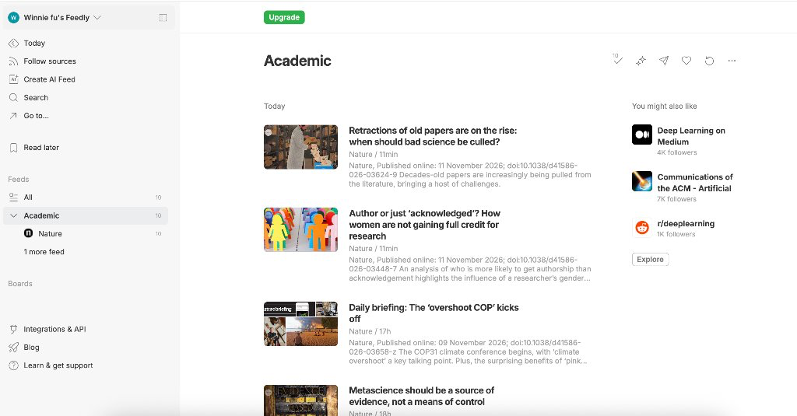

# Entry 2: Introduction to Agentic AI, a hands-on lesson for academic literature management

**Series:** *Prompt & Praxis* (IEEE ProComm) · **Publication date:** 13 November 2026 · **Series Host:** Dr Simon Wang (Language Centre, HKBU)

**Guest Authors:**
- **Wenyun (Winnie) FU**, final-year Journalism undergraduate, HKBU. Human-in-the-loop writing workflows, source verification, literature synthesis.
- **Zian (Andy) Zheng**, final-year Computer Science undergraduate, HKBU. Agentic pipelines, prototyping, API orchestration.

**Table of Contents (Series Navigation):**
- [Entry 1: From plain texts to playable](https://procomm.ieee.org/ai-resources/prompt-and-praxis/entry01/) · *earlier entry*
- [Entry 2: Introduction to Agentic AI](https://procomm.ieee.org/ai-resources/prompt-and-praxis/entry02/) · *reading now*

**Standfirst:** In this entry, we learn how to use agentic AI to enhance the tools for academic literature management that were available through a graphical user interface (GUI) before the advent of vibe coding. WorkBuddy is introduced as a platform to access agentic AI, but instructions and resources are applicable to other agentic AI platforms as well.

---

## Part 1: A hundred open tabs

In July 2022, Maya Gosztyla wrote in the [*Nature* Career Column](https://www.nature.com/articles/d41586-022-01878-7) about the evening her laptop died. More than a hundred papers were waiting in browser tabs, each a promise to read later. When the crash took them, her first feeling was relief: the loss forced a decision she had been postponing.¹

Her article set out four steps: **locate the relevant research literature**, **curate the literature using Zotero**, **read the papers on a set routine**, and **organize your notes in a database you can query**. Locating means finding the journal articles that matter to the researcher; curating means turning those finds into a lasting indexed database. This entry takes the first two; reading and organizing remain human work, since no script supplies the critical judgement they demand. Entry 3 picks up steps three and four.

## Part 2: RSS and Zotero: GUI software solutions for finding and managing research literature

Her fixes were conventional, and they still work well today. An RSS reader brings the literature to you, and a reference manager files it; both are established tools from before AI, and each already encodes a way of working that any researcher can follow. Agentic AI builds on them. With vibe coding we can write small tools that reproduce these workflows, or adopt newer tools designed to work with agents.

### Step 1: Locate the relevant research literature

Stop hunting for new papers and let them come to you. Really Simple Syndication (RSS) is a web feed format that carries updates from websites in a standard, computer-readable structure: each feed document lists new items with a title, a summary and a link, and is republished whenever the source adds something. A reader program follows those addresses and gathers everything you subscribe to into one place, removing the need to check each journal by hand; the same mechanism carries blog posts, news headlines and podcast episodes well beyond academic literature. What you can then do with the stream depends on the reader you choose: a typical reader lets you skim the titles, mark what you have seen and save items for later, while filtering, full-text reading and search vary from reader to reader. The three steps below set up a basic reading routine.

1. **Choose a reader.** Web readers such as [Feedly](https://feedly.com) or [Inoreader](https://www.inoreader.com) need no installation; desktop and mobile readers work offline.
2. **Subscribe with feed addresses.** Paste verified URLs into your reader: [*Nature*](https://www.nature.com/nature.rss), [*Nature Communications*](https://www.nature.com/ncomms.rss), [arXiv cs.AI](https://rss.arxiv.org/rss/cs.AI).
3. **Keep a five-minute morning routine.** Scan titles with your tea, move real candidates to *Read Later*, close the reader.


> **Figure 1** · *Subscribing to journal feeds in Feedly.* An 'Academic' collection aggregates incoming issues from journals like *Nature* and *arXiv cs.AI* into one reading stream, so morning triage needs no extra tabs.

### Step 2: Curate the literature using Zotero

For anyone still formatting references by hand, a reference manager is the first upgrade worth making. It works as a personal research database, where full-text PDFs sit beside verified records, annotations stay bound to their pages, and one click pulls a paper off the web.

We use **Zotero** (free, open source, [zotero.org](https://www.zotero.org)): its metadata and citation engines can be inspected and reused in automated pipelines, and its open architecture keeps data in the scholar's hands. Mendeley and EndNote follow similar patterns.

Four operations complete the loop:

| Operation | What you do in Zotero | Advantage |
|---|---|---|
| **Import** | Browser connector, or by DOI, RIS/BibTeX, PDF drag-and-drop | Metadata and full PDF, no copy-pasting |
| **Organize** | Collections, tags, saved searches, duplicates | Sorted by topic, no duplicated files |
| **Read & annotate** | Built-in reader; highlights become notes | Notes stay attached to the entry |
| **Cite** | Plug-in for Word, LibreOffice, Google Docs | Thousands of styles, bibliography self-updates |


> **Figure 2** · *Literature management in Zotero (Web Library).* Incoming papers are filed into a project collection ('Applied Linguistics & AI' in this illustrative example) with complete metadata, source URL, and DOI captured in one click.

Gosztyla's rule: the moment a paper is worth reading, send it to the manager and close the tab.

Both tools are dependable, and both wait for you once the feeds arrive. Every decision in this workflow runs through an interface: a person clicks the connector, drags the file, scans the list and chooses what to keep, and none of it happens again until someone returns to the screen. That is the practical limit of interface-driven work, and it is the question Part 3 takes up.

## Part 3: Enhancing GUI software solutions with agentic-AI-powered API programming

Every tool in Part 2 reaches you through a graphical user interface (GUI): windows, buttons and menus that a person drives by hand, one screen at a time. The RSS reader shows incoming issues as a list you click through; Zotero shows your library as folders you drag files into. That is the GUI's virtue: a newcomer becomes productive in minutes. It is also its boundary: the screen moves at the speed of fingers and eyes, so it cannot check for new papers while you teach, or repeat last week's multi-filter search without retyping. Gosztyla's hundred tabs were a symptom of that boundary.

Programmed code has no hands or eyes: it runs a query at dawn and repeats yesterday's search next month. An Application Programming Interface (API) is how code reaches such services without a screen: a fixed menu of requests that returns exact, machine-readable records. Part 4 puts this in your hands: you describe the job, and an agent writes and runs the code that calls the API.

|  | Graphical user interface (GUI) | Application Programming Interface (API) |
|---|---|---|
| **Driven by** | fingers and eyes, one screen at a time | requests sent in code, no screen in between |
| **Pace** | as fast as you can click | runs at dawn, repeats on schedule |
| **Good for** | reading, judging, deciding what to keep | searching, collecting, exporting at scale |
| **In this entry** | Feedly and Zotero, from Part 2 | the hands-on build in Part 4 |

[Entry 1](https://procomm.ieee.org/ai-resources/prompt-and-praxis/entry01/) established the bridge that makes this reachable: an agent sits between human language and computing instruments, so you describe a job in ordinary sentences and the agent writes the code that calls the API. Entry 1 also drew a boundary we preserve: **the agent reasons, and the database supplies the facts.**

With an API in hand, both GUI solutions from Part 2 can be rebuilt without their screens: an RSS reader becomes a feed watcher that checks the journal for you, and Zotero becomes a metadata store an agent can query, write records to, and export as BibTeX or RIS. The GUI keeps the part that needs a person: reading critically, and deciding what to keep. Part 4 puts the pipeline into practice.

## Part 4: How you do that, with WorkBuddy

In entry 01 of this blog series, we already showcased the power of agentic AI but did not address the question of how to start. In this entry, we demonstrate how to use agentic AI hands-on. WorkBuddy is an agentic AI platform developed by Tencent, an internet giant based in mainland China. If you wish to try the tool, you may sign up for an account here: https://www.workbuddy.ai/.

WorkBuddy is not the only tool for agentic AI: integrated development environments (IDEs) such as VS Code, Codex, Claude Code and Cursor now ship agentic-AI modules, but those tools are built for professional programmers and developers, and a beginner would find them difficult to pick up. This entry runs in WorkBuddy instead, where you start from plain sentences.

Before the hands-on part, revisit Entry 01's input-process-output model: plain sentences in, code written and run, files and tables out. Keep it in view to understand the big picture of what the two tracks below do.

<div class="figure-scroll" style="overflow-x:auto"><svg class="flow" viewBox="0 0 920 210" role="img" aria-label="Flow: a plain-language brief and source material feed an agentic AI that writes code and calls tools, producing something playable" style="max-width:100%;height:auto">
  <defs>
    <marker id="ar" viewBox="0 0 10 10" refX="9" refY="5" markerWidth="7" markerHeight="7" orient="auto-start-reverse">
      <path d="M0 0 L10 5 L0 10 z" fill="#006699"/>
    </marker>
  </defs>
  <rect x="8" y="35" width="255" height="140" rx="14" fill="#fff" stroke="#dde5ee"/>
  <text x="135" y="66" text-anchor="middle" font-size="15" font-weight="700" fill="#1f2d3a">Plain-language brief</text>
  <text x="135" y="94" text-anchor="middle" font-size="12.5" fill="#5c6f83">a permissioned article</text>
  <text x="135" y="114" text-anchor="middle" font-size="12.5" fill="#5c6f83">Google's published research</text>
  <text x="135" y="145" text-anchor="middle" font-size="12.5" fill="#b35c00" font-weight="700">quality input</text>
  <rect x="330" y="35" width="255" height="140" rx="14" fill="#006699"/>
  <text x="457" y="66" text-anchor="middle" font-size="15" font-weight="700" fill="#fff">Agentic AI</text>
  <text x="457" y="94" text-anchor="middle" font-size="12.5" fill="#cfe3f2">writes programming code</text>
  <text x="457" y="114" text-anchor="middle" font-size="12.5" fill="#cfe3f2">calls tools &amp; APIs</text>
  <text x="457" y="145" text-anchor="middle" font-size="12.5" fill="#ffd9a8" font-weight="700">reasoning / processing</text>
  <rect x="652" y="35" width="255" height="140" rx="14" fill="#fff" stroke="#f2c58c" stroke-width="2"/>
  <text x="779" y="66" text-anchor="middle" font-size="15" font-weight="700" fill="#1f2d3a">Playable</text>
  <text x="779" y="94" text-anchor="middle" font-size="12.5" fill="#5c6f83">an interactive page</text>
  <text x="779" y="114" text-anchor="middle" font-size="12.5" fill="#5c6f83">that runs, not a reply</text>
  <text x="779" y="145" text-anchor="middle" font-size="12.5" fill="#b35c00" font-weight="700">output</text>
  <line x1="263" y1="105" x2="328" y2="105" stroke="#006699" stroke-width="2.5" marker-end="url(#ar)"/>
  <line x1="585" y1="105" x2="650" y2="105" stroke="#006699" stroke-width="2.5" marker-end="url(#ar)"/>
  <text x="460" y="196" text-anchor="middle" font-size="12" fill="#5c6f83">The pipeline of this entry, drawn in code — no image generator involved.</text>
</svg></div>

The companion workshop page here collects everything needed for both tracks; Track B runs in WorkBuddy using Python 3 from the repository root.

### Track A: describe the task from scratch

Track A aims at one completed pass: plan the query, run it, and read the records that come back. Use WorkBuddy with network access and a writable workspace; it writes and runs its own code. The first two prompts deliver that pass; the last two are optional extensions once it works.

1. **A1: Planning contract.** Establish rules first:
   > "I am new to this. Before doing anything: tell me in three bullet points what this prompt would do, what information you need from me, and what could go wrong. Do not run it yet:
   > 'Find the 5 most relevant papers on automated written corrective feedback published since 2024 from OpenAlex, and show Title, Year, Citations, and DOI.'"
2. **A2: Query OpenAlex.** Once the agent outlines its plan, send:
   > "Query OpenAlex Works API for the 5 most relevant articles on automated written corrective feedback since 2024 using default relevance sorting. Omit the email parameter. Output a table: Title | Year | Citations | DOI. Every row must come strictly from API metadata; leave missing fields blank and never fabricate publications."
   *Outcome:* Up to five records appear. Check titles, open an available DOI. Ranking is not quality assessment.
3. **A3: Save to CSV.** Ask:
   > "Save this table to `found.csv` with columns: OpenAlex_ID, Title, Authors, Year, Citations, DOI, Journal, Reading_Status, Notes. Set Reading_Status to Unread and leave Notes blank."
   *Outcome:* `found.csv` opens in Excel, Google Sheets, or Tencent Docs as a durable reading log.
4. **A4: Export to BibTeX and RIS.** Prompt:
   > "Convert the returned records into standard `found.bib` and `found.ris` files with clean citekeys, author separation, and DOIs preserved."
   *Outcome:* In Zotero, choose File → Import and check the records.

**What a real pass returns.** The workshop's own run of this prompt (12 Nov 2026) matched 11,915 works and brought back five records.²

| Title | Year | Citations | DOI |
|---|---|---|---|
| L2 writer engagement with automated written corrective feedback provided by ChatGPT: A mixed-method multiple case study | 2024 | 171 | [10.1057/s41599-024-03543-y](https://doi.org/10.1057/s41599-024-03543-y) |
| Effectiveness of Generative AI in Automated Written Corrective Feedback With Prompting | 2025 | 19 | [10.1177/07356331251359430](https://doi.org/10.1177/07356331251359430) |
| Impact of prompt sophistication on ChatGPT’s output for automated written corrective feedback | 2025 | 12 | [10.1017/s095834402510044x](https://doi.org/10.1017/s095834402510044x) |
| Automated Written Corrective Feedback (AWCF) | 2024 | 1 | [10.1163/9789004719118_009](https://doi.org/10.1163/9789004719118_009) |
| Automated Written Corrective Feedback in EFL context | 2026 | 0 | [10.48321/d13320141e](https://doi.org/10.48321/d13320141e) |

Records from the workshop run of 12 Nov 2026; titles and metadata verified against OpenAlex on 16 Nov 2026.

### Track B: reuse the prepared Python script

Ask WorkBuddy to explain and run the script documented in [`workshop/prompts/beginner-pack.md`](https://github.com/tesolchina/promptpraxis/blob/main/workshop/prompts/beginner-pack.md):

```bash
python3 workshop/fetch_literature.py \
  --topic "automated written corrective feedback" \
  --year 2024 \
  --sort relevance \
  --limit 5 \
  --email=
```

- **Output:** writes `found.csv`, `found.bib`, and `found.ris`. Missing metadata stays empty; nothing is invented.
- **Customisation:** change `--topic`, `--year`, or the sort order.
- **Edge cases:** no matches writes empty files; offline, add `--fixture workshop/tests/fixtures/openalex_normal.json`.

## Part 5: What we chose to cover, what can go wrong, and why upgrading beats rebuilding

**Decisions:** We limit the lesson to find and manage; an entry attempting everything teaches nothing. BibTeX/RIS export stays the dependable bridge to reference managers.

**Limits:** Language models can invent or miscopy citations even when tools are available. Compare outputs with the saved API response, keep missing fields empty, and judge relevance yourself. A DOI identifies a record; it does not establish the quality of its claims or guarantee free full text. API conditions change, so stop on errors.

**Value:** An afternoon of tab chasing becomes a two-minute query; next month's review is this month's prompt with a new date filter.

**Conclusion: from tool users to tool builders.** The starting point of this entry is deliberately not the latest AI technology. It is a workflow proposed before generative AI became widely available — Maya Gosztyla's four steps, built entirely from ordinary GUI software: RSS feeds and Zotero. Our strategy is to take well-established solutions like these and let agentic AI upgrade them instead of starting from scratch. Two properties make that possible. RSS is a machine-readable format, so an agent can vibe-code a small tool that reads a feed and processes what it finds. Zotero is open-source, so an agent can read its source code and re-use it to replicate functions such as export and tagging. Re-using the code and ideas of pre-AI tools brings the flexibility to add custom features on top, and the cumulative effect is a shift in role: from tool users to tool builders.

## Closing: starting the cycle

Open one paper today, rerun the prompt next week, and the pipeline becomes daily practice.

---

**Footnotes:** ¹ Gosztyla, M. (2022). *How to find, read and organize papers*. Nature Careers, 07 July 2022. doi:10.1038/d41586-022-01878-7. ² Companion run evidence: [WorkBuddy two-track comparison](https://github.com/tesolchina/promptpraxis/blob/main/workshop/evidence/two-track-20261112/cross_check.txt).
